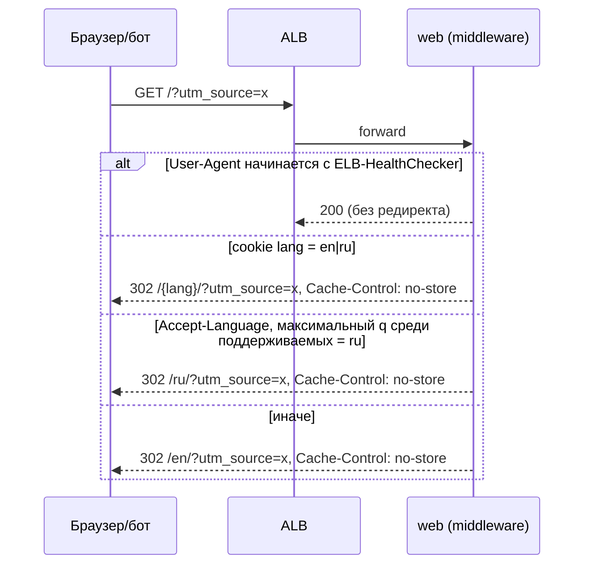
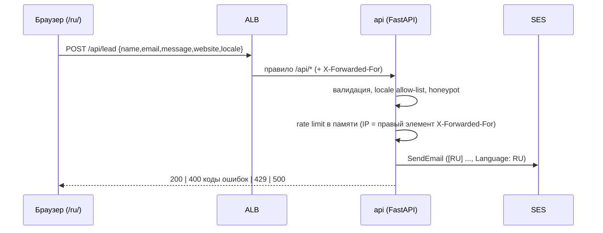
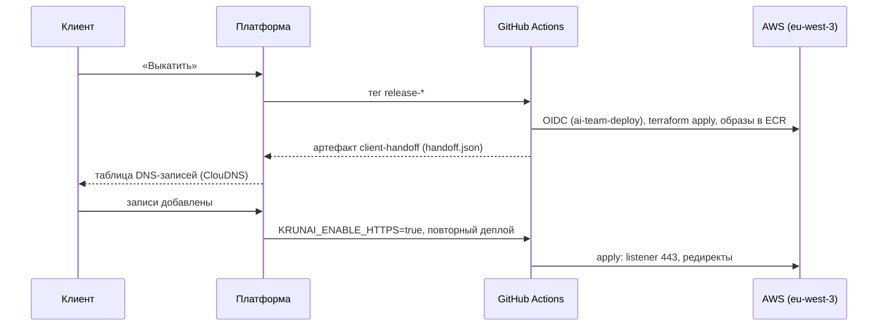

# Архитектура krunai.uz

Источники: `docs/spec/v4-technical.md` (актуальное ТЗ: golden path, деплой по контракту платформы), `docs/spec/v1-technical.md`–`v3-technical.md` (контент, i18n, DNS/SES), `docs/platform-contract.md` (обязательные правила деплоя). Решения зафиксированы в ADR: [0001](adr/0001-stack-and-repo-layout.md), [0002](adr/0002-i18n-static-locales.md), [0003](adr/0003-edge-locale-detection.md) (заменён), [0004](adr/0004-external-dns-ses-domain-identity.md) (частично заменён), [0005](adr/0005-ecs-fargate-golden-path.md), [0006](adr/0006-platform-deploy-and-handoff.md).

## 1. Обзор

Двуязычный (EN/RU) одностраничный лендинг платформы KRunAI. Регион AWS — **eu-west-3 (Paris)**. Два сервиса ECS Fargate за одним Application Load Balancer: `web` (Next.js) и `api` (Python/FastAPI, приём заявок). Базы данных нет.

```mermaid
flowchart LR
    V[Посетитель] -->|HTTP 80 / HTTPS 443| ALB[ALB eu-west-3<br/>krunai.uz, www.krunai.uz]
    ALB -->|"default /*"| WEB[ECS Fargate: web<br/>Next.js standalone :3000]
    ALB -->|"/api/*"| API[ECS Fargate: api<br/>FastAPI + uvicorn :8000]
    API --> SES[Amazon SES<br/>eu-west-3, identity krunai.uz]
    WEB --> CW[CloudWatch Logs]
    API --> CW
    SES -->|noreply@krunai.uz → gulmira@krunai.uz| M[Zoho Mail<br/>gulmira@krunai.uz]
    ECR[ECR web, api] -.образы.-> WEB
    ECR -.образы.-> API
    DNS[ClouDNS<br/>вносит клиент] -.ALIAS/CNAME.-> ALB
    DNS -.DKIM, MAIL FROM.-> SES
    ACM[ACM eu-west-3] -.TLS.-> ALB
```

## 2. Компоненты

| Компонент | Назначение |
|---|---|
| `apps/web` | Next.js + TypeScript strict + Tailwind, `output: 'standalone'`, порт 3000. Локали `/en`, `/ru`. Middleware определяет локаль для `/` (раздел 3.1). |
| `apps/api` | Python 3.12 + FastAPI + uvicorn, порт 8000. `GET /api/health`, `POST /api/lead`: валидация, honeypot, `locale` по allow-list (`en`\|`ru`, по умолчанию `en`), rate limit, отправка письма через SES. Логи JSON, email маскируется, содержимое сообщений не логируется. |
| ALB | Один, listener 80 (и 443 при `enable_https=true`). `/api/*` → target group api (health `GET /api/health`), остальное → target group web (health `GET /`). Правила — раздел 3.5 и 8. SG: вход только 80/443. |
| ECS Fargate | Один кластер, сервисы web и api: по 1 задаче 0.25 vCPU / 0.5 GB, автоскейлинг до 2. Публичные подсети без NAT, публичный IP у задач; SG задач — вход только от SG ALB (3000, 8000). |
| ECR | Два репозитория (web, api); образы с тегом = SHA коммита. |
| Amazon SES (eu-west-3) | Domain identity `krunai.uz`, Easy DKIM (3 CNAME), custom MAIL FROM `mail.krunai.uz`; From `noreply@krunai.uz`, To `gulmira@krunai.uz` (из `LEAD_RECIPIENT_EMAIL`), `Reply-To` = email посетителя, тег `[RU]`/`[EN]` в теме и `Language: RU\|EN` в теле. При sandbox — `ses_verify_recipient=true` верифицирует получателя. Task role api: только `ses:SendEmail` на identity `krunai.uz`. |
| ACM (eu-west-3) | Сертификат `krunai.uz` + `www.krunai.uz` с DNS-валидацией; привязывается к ALB на этапе 2 (ADR 0006). |
| ClouDNS | DNS остаётся у клиента (Route 53 не используется); записи вносятся по таблице от платформы (раздел 8.3). Записи Zoho (MX, SPF, DKIM zmail, DMARC) не изменяются и в outputs не входят (ADR 0004). |
| CloudWatch | Log groups web и api, retention 30 дней; alarm на bounce/complaint rate SES (SNS → `alarm_email`, если задан). |
| Terraform (`infra/terraform`) | Terraform >= 1.6, AWS provider ~> 5; state — S3 backend платформы, key `test1/terraform.tfstate`. |
| GitHub Actions | `ci.yml` — сборка, линтеры, тесты, Docker-образы; `deploy.yml` — только по тегу `release-*` (раздел 8). |

Сквозное: Node.js 20 LTS (web), Python 3.12 (api), документация на русском. Безопасность: HSTS, `X-Content-Type-Options`, `Referrer-Policy`, CSP — заголовки задаёт web (Next.js `headers()`); долгоживущих ключей AWS нет.

## 3. Потоки запросов

### 3.1. `GET /` — редирект по локали (Next.js middleware)



Порядок: cookie → `Accept-Language` с учётом q → `en`. Query string сохраняется. Cookie `lang=en|ru; Path=/; Max-Age=31536000; SameSite=Lax; Secure` ставит переключатель языка. Боты обрабатываются так же (без клоакинга). Health-check ALB (`ELB-HealthChecker*`) получает 200 на `/` без редиректа (ADR 0005).

### 3.2. `GET /en/`, `GET /ru/` и прочие пути

Редиректов нет: сервис web отдаёт страницу нужной локали (200, `<html lang>`). Хэшированные ассеты — `Cache-Control: public, max-age=31536000, immutable`, HTML — `no-cache`.

### 3.3. Неизвестный путь → 404

Next.js отдаёт страницу 404 со статусом 404; локаль определяется по префиксу пути (`/ru/...` → RU-текст, иначе EN). См. ADR 0002.

### 3.4. `POST /api/lead`



Фронтенд отображает локализованный текст по коду ошибки. Сбой SES → 500 `internal_error` и запись в лог. При `LEAD_EMAIL_DRY_RUN=true` SES не вызывается (тесты, e2e). Rate limit: 5 заявок в 60 с с IP; счётчик в памяти задачи, при 2 задачах лимит действует на задачу (ADR 0005). CORS: `ALLOWED_ORIGINS`.

### 3.5. Маршрутизация ALB

| Условие | `enable_https=false` | `enable_https=true` |
|---|---|---|
| Listener 80 | forward: `/api/*` → api, default → web | 301 `https://krunai.uz:443#{path}?#{query}` |
| Listener 443 | нет | ACM eu-west-3, `ELBSecurityPolicy-TLS13-1-2-2021-06`: host `www.krunai.uz` → 301 `https://krunai.uz`; `/api/*` → api; default → web |

При `canonical_host = www.krunai.uz` (fallback без ALIAS) редирект инвертируется: apex → 301 на www; apex в ClouDNS — веб-редирект.

### 3.6. `GET /api/health`

`200 {"status":"ok"}`, используется health-check target group api.

### 3.7. Контракт `POST /api/lead`

Источник правды: [`contracts/openapi.yaml`](../contracts/openapi.yaml) (OpenAPI 3.1, линтер: `npx @redocly/cli lint contracts/openapi.yaml`).

Тело запроса (JSON): `name` (1–100, обязательно), `email` (обязательно), `message` (10–2000, обязательно), `locale` (`en`\|`ru`, необязательно, по умолчанию `en`), `website` (honeypot, должен быть пустым). Заполненный honeypot → `200 {"ok": true}` без отправки письма.

Сервер не возвращает человекочитаемых текстов, только коды; фронтенд маппит их на локализованные строки.

| HTTP | Тело | Когда |
|------|------|-------|
| 200 | `{"ok": true}` | Успех, в т.ч. сработавший honeypot |
| 400 | `{"error":"validation_error","fields":{"<field>":"<code>"}}` | Ошибка валидации полей (`name`, `email`, `message`, `locale`) |
| 400 | `{"error":"bad_request"}` | Невалидный JSON |
| 429 | `{"error":"rate_limited"}` | Превышен rate limit |
| 500 | `{"error":"internal_error"}` | Внутренний сбой, в т.ч. ошибка SES |

Коды полей (`fields.<field>`): `required` (нет или пусто), `invalid_format` (например, email), `too_short` (`message` < 10), `too_long`, `invalid_value` (`locale` вне allow-list).

## 4. Структура репозитория

```
apps/web/              Next.js (standalone), messages/{en,ru}.json, middleware, Dockerfile
apps/api/              FastAPI (Python 3.12), тесты, Dockerfile
infra/terraform/       Terraform: сеть, ALB, ECS, ECR, ACM, SES, IAM, CloudWatch, handoff
contracts/openapi.yaml OpenAPI контракт (health, POST /api/lead)
design/                бренд-материалы: логотип, палитра, OG-изображение
e2e/                   Playwright E2E (api с LEAD_EMAIL_DRY_RUN=true)
.github/workflows/     ci.yml (сборка/тесты/образы), deploy.yml (только тег release-*)
docs/                  architecture.md, adr/, spec/, platform-contract.md, deploy.md
```

Корневой `package.json`: workspaces `["apps/web","e2e"]`; `apps/api` — Python-проект со своими зависимостями и тестами.

## 5. Переменные окружения

### 5.1. web

| Переменная | Когда | Значение |
|---|---|---|
| `PORT` | runtime | `3000` |
| `HOSTNAME` | runtime | `0.0.0.0` |
| `NEXT_PUBLIC_SITE_URL` | build-time | `https://krunai.uz` (canonical, hreflang, sitemap, og:url) |
| `NEXT_PUBLIC_LEAD_API_PATH` | build-time | `/api/lead` |

### 5.2. api

| Переменная | Значение |
|---|---|
| `LEAD_RECIPIENT_EMAIL` | `gulmira@krunai.uz` (из Terraform `lead_recipient_email`, из запроса не принимается) |
| `LEAD_FROM_EMAIL` | `noreply@krunai.uz` (из `lead_from_email`) |
| `AWS_REGION` | `eu-west-3` |
| `RATE_LIMIT_MAX` | `5` |
| `RATE_LIMIT_WINDOW_SECONDS` | `60` |
| `ALLOWED_ORIGINS` | `https://krunai.uz,https://www.krunai.uz` |
| `LEAD_EMAIL_DRY_RUN` | `false`; `true` — SES не вызывается (тесты/e2e) |
| `LOG_LEVEL` | `INFO` |

Секреты в репозитории не хранятся; AWS-доступ в CI — через OIDC-роль платформы.

### 5.3. Переменные Terraform

| Переменная | По умолчанию | Назначение |
|---|---|---|
| `project_name` | `krunai` | Префикс имён ресурсов |
| `aws_region` | `eu-west-3` | Регион |
| `domain_name` | `krunai.uz` | Домен сайта и SES identity |
| `canonical_host` | `krunai.uz` (или `www.krunai.uz`) | Канонический хост; `www`, если в ClouDNS нет ALIAS |
| `enable_https` | `false` | Этап 2: сертификат, listener 443, редиректы (`TF_VAR_enable_https` ← `KRUNAI_ENABLE_HTTPS`) |
| `web_image` | без default | URI образа web (ECR, тег = SHA) |
| `api_image` | без default | URI образа api |
| `lead_recipient_email` | `gulmira@krunai.uz` | Источник `LEAD_RECIPIENT_EMAIL` |
| `lead_from_email` | `noreply@krunai.uz` | Источник `LEAD_FROM_EMAIL` |
| `ses_mail_from_subdomain` | `mail` | Поддомен custom MAIL FROM |
| `ses_verify_recipient` | `true` | Верифицировать адрес получателя (SES sandbox) |
| `alarm_email` | `''` | Получатель SNS-алармов; пусто — без подписки |
| `permissions_boundary_arn` | без default | Граница прав для всех IAM-ролей (`TF_VAR_permissions_boundary_arn`) |

### 5.4. Outputs Terraform

| Output | Содержимое |
|---|---|
| `alb_dns_name`, `alb_zone_id` | Адрес ALB |
| `acm_validation_records` | `[{name,type,value}]` для валидации сертификата |
| `ses_dkim_records` | 3 CNAME `<token>._domainkey` → `<token>.dkim.amazonses.com` |
| `ses_mail_from_records` | MX `mail` → `10 feedback-smtp.eu-west-3.amazonses.com`; TXT `mail` → `v=spf1 include:amazonses.com ~all` |
| `ecr_web_repository_url`, `ecr_api_repository_url` | Репозитории ECR |
| `ecs_cluster_name`, `ecs_web_service_name`, `ecs_api_service_name` | Для проверки стабилизации сервисов |
| `site_url` | `http://<alb_dns_name>` при `enable_https=false`, иначе `https://krunai.uz` |
| `dns_records` | `[{type,name,value,purpose}]` — все записи раздела 3 ТЗ v4 (ACM, ALIAS apex, CNAME www, 3 DKIM, MX и TXT `mail`) |

Записи MX, SPF, DKIM zmail и DMARC Zoho **не изменяются** и в outputs не входят.

### 5.5. Открытые вопросы ТЗ и влияние на реализацию

| Вопрос | Влияние |
|---|---|
| Есть ли ALIAS в тарифе ClouDNS | Нет → `canonical_host = "www.krunai.uz"`, apex — веб-редирект ClouDNS; синхронизировать `NEXT_PUBLIC_SITE_URL`, canonical/hreflang, sitemap |
| SES в sandbox | Да → `ses_verify_recipient=true` и запрос на выход из sandbox в отчёте о выкатке |
| Сохранять ли заявки | Сейчас нет (БД не используется, ADR 0005) |

## 6. i18n и SEO

- Локали: `en` (default/fallback), `ru`. Сообщения: `apps/web/messages/{en,ru}.json`, список локалей — единый модуль `apps/web/src/i18n/config.ts` (ADR 0002).
- CI-проверка: ключи `en` и `ru` совпадают, иначе сборка падает.
- На каждой странице: `<html lang>`, canonical, `hreflang` en/ru/x-default (→ `/en/`), `og:locale` (`en_US`/`ru_RU`) + `og:locale:alternate`; `sitemap.xml` с обеими локалями и alternates.
- Шрифты с кириллицей; вёрстка выдерживает длинные RU-строки при 320 px.

## 7. Как добавить новую локаль

Например, `uz`:

1. Создать `apps/web/messages/uz.json` с тем же набором ключей, что в `en.json`.
2. Добавить `uz` в `apps/web/src/i18n/config.ts` (и маппинг `og:locale`, например `uz_UZ`).
3. Если локаль определяется автоматически — добавить её в список поддерживаемых в middleware `apps/web`, в allow-list `locale` в `apps/api` и `contracts/openapi.yaml`.
4. Добавить локализованный текст 404 и обновить E2E.
5. Прогнать линтеры и сборку (проверка ключей) и выкатить.

Новая инфраструктура не требуется.

## 8. Деплой

Регламент — `docs/platform-contract.md`, решения — ADR 0006.

### 8.1. Процесс

1. Клиент подключает AWS кнопкой «Подключить AWS» (/aws); платформа прописывает в репозиторий переменные Actions: `AWS_DEPLOY_ROLE_ARN`, `AWS_REGION`, `AWS_ACCOUNT_ID`, `AWS_PERMISSIONS_BOUNDARY_ARN`, `TF_STATE_BUCKET`, `TF_LOCK_TABLE`.
2. CI на push/PR только собирает, линтит, тестирует и собирает Docker-образы; деплоя в AWS нет.
3. После подтверждения клиентом («Выкатить», /deploy) платформа ставит тег `release-*`; запускается `deploy.yml` (единственный триггер — тег): сборка и тесты → Terraform (инфраструктура, ECR) → push образов web/api → `terraform apply` → ожидание стабильности ECS-сервисов → артефакт `client-handoff` (`handoff.json`).
4. Платформа отправляет клиенту таблицу DNS, проверяет записи и выполняет `after_dns`.

State: S3 backend, key `test1/terraform.tfstate`, bucket/таблица блокировок/регион из `TF_STATE_BUCKET`/`TF_LOCK_TABLE`/`AWS_REGION`. Все IAM-роли с `permissions_boundary_arn`; имена без префикса `ai-team-`. `concurrency: {group: deploy, cancel-in-progress: false}`.



### 8.2. Двухэтапный HTTPS

| Этап | `enable_https` | `site_url` | Что работает |
|---|---|---|---|
| 1 | `false` | `http://<alb_dns_name>` | Сайт и `POST /api/lead` по HTTP на DNS-имени ALB |
| 2 | `true` | `https://krunai.uz` | HTTPS, 301 с http:// и www на `https://krunai.uz` |

### 8.3. `handoff.json`

```json
{
  "zone": "krunai.uz",
  "site_url": "http://<alb_dns_name>",
  "dns_records": [{"type": "CNAME", "name": "<полное имя>", "value": "<значение>", "purpose": "<назначение>"}],
  "after_dns": {"set_variables": {"KRUNAI_ENABLE_HTTPS": "true"}, "redeploy": true}
}
```

`dns_records` = output `dns_records`: CNAME валидации ACM (1–2), ALIAS `krunai.uz` → `alb_dns_name`, CNAME `www` → `alb_dns_name`, 3 CNAME DKIM, MX `mail` (priority 10), TXT `mail`.

## 9. Нефункциональные требования и ограничения

- Безопасность: SG задач принимают трафик только от ALB, ALB — только 80/443; task role api — только `ses:SendEmail`; HSTS, CSP, TLS 1.3/1.2 политика.
- Lighthouse (mobile) ≥ 90 в обеих локалях; нет overflow на 320/768/1440 px.
- Логи 30 дней, без содержимого сообщений, email маскируется.
- Вне рамок: другие локали, CMS, аналитика, хранение заявок.

## 10. История: что заменено в v4

До v4 использовалась схема S3 + CloudFront (Function `locale-router`) + API Gateway + Lambda + DynamoDB (rate limit), деплой из `main` через OIDC-роль `infra/terraform/bootstrap`, флаг `enable_custom_domain`. Всё это заменено ADR 0005 и 0006 (ADR 0003 — заменён, ADR 0004 — частично). Удаление старого кода, Terraform и workflows выполняют другие тикеты эпика v4.
