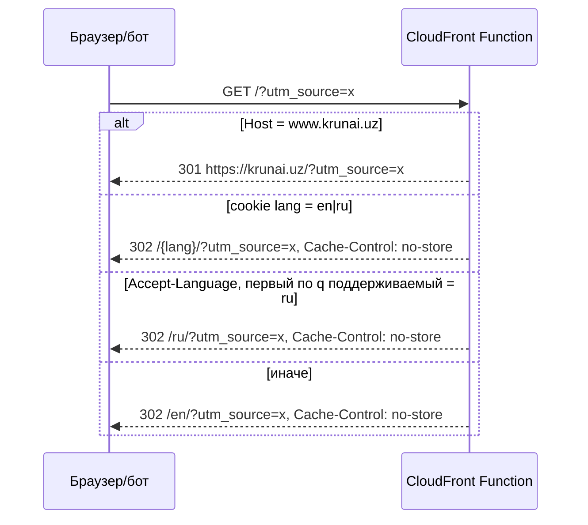
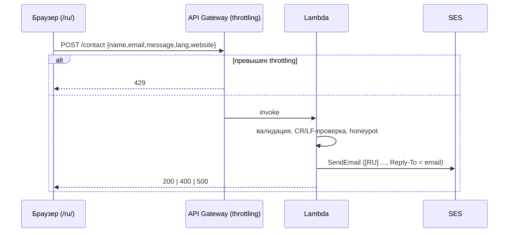
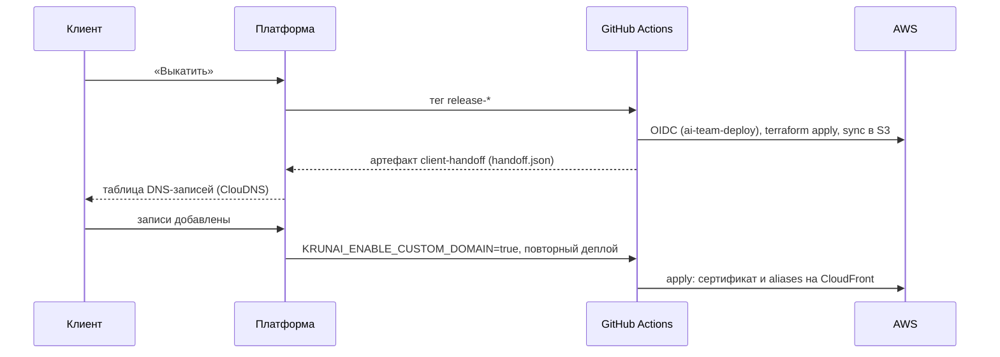

# Архитектура krunai.uz

Источники: `docs/spec/v5-technical.md` (актуальное ТЗ: serverless, базовый вариант), `docs/spec/v1-technical.md`–`v4-technical.md` (контент, i18n, DNS/SES), `docs/platform-contract.md` (обязательные правила деплоя). Решения зафиксированы в ADR: [0001](adr/0001-stack-and-repo-layout.md), [0002](adr/0002-i18n-static-locales.md), [0003](adr/0003-edge-locale-detection.md), [0004](adr/0004-external-dns-ses-domain-identity.md) (частично заменён), [0006](adr/0006-platform-deploy-and-handoff.md) (изменён), [0007](adr/0007-serverless-static-site-and-lambda.md) (текущая архитектура).

## 1. Обзор

Двуязычный (EN/RU) одностраничный лендинг платформы KRunAI. Регион AWS — **eu-west-3 (Paris)**, сертификат ACM для CloudFront — us-east-1. Статический сайт в S3 за CloudFront, форма заявки — API Gateway HTTP API → Lambda (Python) → SES. Базы данных и хранилища заявок нет.

```mermaid
flowchart LR
    V[Посетитель] -->|HTTPS| CF[CloudFront<br/>krunai.uz, www.krunai.uz]
    CF -->|viewer-request| FN[CloudFront Function<br/>www→apex, / → /lang/]
    CF -->|OAC| S3[(S3 site bucket<br/>private)]
    V -->|"POST /contact"| APIGW[API Gateway HTTP API<br/>$default, throttling]
    APIGW --> L[Lambda Python 3.12]
    L -->|ses:SendEmail| SES[Amazon SES<br/>eu-west-3, identity krunai.uz]
    SES -->|noreply@krunai.uz → gulmira@krunai.uz| M[Zoho Mail]
    L --> CW[CloudWatch Logs + Alarms]
    CW --> SNS[SNS → alarm_email]
    DNS[ClouDNS<br/>вносит клиент] -.ALIAS/CNAME.-> CF
    DNS -.DKIM, MAIL FROM.-> SES
    ACM[ACM us-east-1] -.TLS.-> CF
```

## 2. Компоненты

| Компонент | Назначение |
|---|---|
| `apps/web` | Next.js + TypeScript strict + Tailwind, `output: 'export'`, `trailingSlash: true`. Локали `/en/`, `/ru/`. Форма отправляет `POST` на `NEXT_PUBLIC_LEAD_API_URL`. |
| `apps/lambda` | Python 3.12: валидация, honeypot, отправка письма через SES v2. Логи JSON без PII. |
| S3 | Бакет сайта: private, Block Public Access, доступ только через OAC; прямой доступ к объектам — 403. |
| CloudFront | HTTPS only, redirect HTTP→HTTPS, сжатие, кэш ассетов (`immutable` для хэшированных файлов, HTML — `no-cache`). Aliases `krunai.uz`, `www.krunai.uz` на этапе 2 (раздел 8.2). |
| CloudFront Function | `viewer-request`, `cloudfront-js-2.0`, исходник `infra/functions/`: www → apex 301, `/` → локаль, `/x/` → `/x/index.html` (ADR 0003). |
| API Gateway HTTP API | Маршрут `POST /contact`, stage `$default`, throttling `api_throttle_rate`/`api_throttle_burst`, CORS: `https://krunai.uz` и localhost для dev. |
| Lambda | Единственный backend; IAM-роль: `ses:SendEmail` на identity `krunai.uz` и запись в свои логи, с `permissions_boundary_arn`. |
| Amazon SES (eu-west-3) | Domain identity `krunai.uz`, Easy DKIM (3 CNAME), custom MAIL FROM `mail.krunai.uz`; From `noreply@krunai.uz`, To `gulmira@krunai.uz`, `Reply-To` = email посетителя; в письме имя, email, сообщение, язык (EN/RU), время UTC. |
| ACM (us-east-1) | Сертификат `krunai.uz` + `www.krunai.uz` с DNS-валидацией; привязывается к CloudFront на этапе 2 (ADR 0006). |
| ClouDNS | DNS остаётся у клиента (Route 53 не используется); записи вносятся по таблице платформы. Записи Zoho (MX, SPF, DKIM zmail, DMARC) не изменяются и в outputs не входят (ADR 0004). |
| CloudWatch | Log groups Lambda и API Gateway, `log_retention_days=30`; alarms — раздел 9. |
| Terraform (`infra/terraform`) | Terraform >= 1.6, AWS provider ~> 5 (alias `us_east_1` для ACM); state — S3 backend платформы, key `test1/terraform.tfstate`. |
| GitHub Actions | `ci.yml` — сборка, линтеры, тесты; `deploy.yml` — только по тегу `release-*` (раздел 8). |

Сквозное: Node.js 20 LTS (web), Python 3.12 (Lambda), документация на русском. Долгоживущих ключей AWS нет.

## 3. Потоки запросов

### 3.1. `GET /` — редирект по локали (CloudFront Function)



Порядок: cookie → `Accept-Language` с учётом q → `en`. Query string сохраняется. Cookie `lang=en|ru; Path=/; Max-Age=31536000; SameSite=Lax; Secure` ставит переключатель языка. Боты обрабатываются так же (без клоакинга).

### 3.2. www → apex

Любой путь на `www.krunai.uz`: `301 https://krunai.uz{path}?{query}` (например, `/foo?x=1` → `https://krunai.uz/foo?x=1`). Выполняет CloudFront Function до остальной логики.

### 3.3. `GET /en/`, `GET /ru/` и прочие пути

Редиректов нет: CloudFront отдаёт статику из S3 (200, `<html lang>`); Function переписывает `/x/` → `/x/index.html`. Неизвестный путь — страница 404 со статусом 404 (custom error response на `/404.html`); локаль по префиксу пути (ADR 0002).

### 3.4. `POST /contact`



Фронтенд показывает локализованный текст по коду ошибки/статусу. Сбой SES → 500 `internal_error` и запись в лог. При `LEAD_EMAIL_DRY_RUN=true` SES не вызывается (тесты, e2e). Honeypot (`website` непусто) → `200 {"ok": true}`, письма нет, в лог — событие `honeypot_triggered` без PII.

### 3.5. Контракт `POST /contact`

Источник правды: [`contracts/openapi.yaml`](../contracts/openapi.yaml) (OpenAPI 3.1, линтер: `npx @redocly/cli lint contracts/openapi.yaml`).

Тело (JSON): `name` (1–100), `email` (формат email, ≤254), `message` (1–5000), `lang` (`en`\|`ru`), `website` (honeypot, должен быть пустым). Все поля обязательны (`website` может быть пустой строкой). CR/LF в `name` и `email` → `invalid_format`.

| HTTP | Тело | Когда |
|------|------|-------|
| 200 | `{"ok": true}` | Успех, в т.ч. сработавший honeypot |
| 400 | `{"error":"validation_error","fields":{"<field>":"<code>"}}` | Ошибка валидации полей |
| 400 | `{"error":"bad_request"}` | Невалидный JSON / не объект |
| 429 | не гарантировано | Throttling API Gateway |
| 500 | `{"error":"internal_error"}` | Внутренний сбой, в т.ч. ошибка SES |

Коды полей: `required`, `invalid_format`, `too_long`, `invalid_value` (`lang` вне `en|ru`). Сервер не возвращает человекочитаемых текстов.

## 4. Структура репозитория

```
apps/web/              Next.js (static export), messages/{en,ru}.json
apps/lambda/           Python 3.12 Lambda (contact), тесты
infra/terraform/       Terraform: S3, CloudFront, API GW, Lambda, SES, ACM, IAM, CloudWatch, handoff
infra/functions/       Исходник CloudFront Function
contracts/openapi.yaml OpenAPI контракт (POST /contact)
design/                бренд-материалы: логотип, палитра, OG-изображение
e2e/                   Playwright E2E (Lambda с LEAD_EMAIL_DRY_RUN=true)
.github/workflows/     ci.yml (сборка/тесты), deploy.yml (только тег release-*)
docs/                  architecture.md, adr/, spec/, platform-contract.md
```

Корневой `package.json`: workspaces `["apps/web","e2e"]`; `apps/lambda` — Python-проект со своими зависимостями и тестами.

## 5. Переменные окружения

### 5.1. web (build-time)

| Переменная | Значение |
|---|---|
| `NEXT_PUBLIC_SITE_URL` | `https://krunai.uz` (canonical, hreflang, sitemap, og:url) |
| `NEXT_PUBLIC_LEAD_API_URL` | invoke URL API Gateway + `/contact` (из output `api_endpoint`) |

### 5.2. Lambda

| Переменная | Значение |
|---|---|
| `LEAD_RECIPIENT_EMAIL` | `gulmira@krunai.uz` (из `lead_recipient_email`, из запроса не принимается) |
| `LEAD_FROM_EMAIL` | `noreply@krunai.uz` (из `lead_from_email`) |
| `LEAD_EMAIL_DRY_RUN` | `false`; `true` — SES не вызывается (тесты/e2e) |
| `LOG_LEVEL` | `INFO` |

Секреты в репозитории не хранятся; AWS-доступ в CI — через OIDC-роль платформы.

### 5.3. Переменные Terraform

| Переменная | По умолчанию | Назначение |
|---|---|---|
| `project_name` | `krunai` | Префикс имён ресурсов |
| `domain_name` | `krunai.uz` | Домен сайта и SES identity |
| `canonical_host` | `krunai.uz` (или `www.krunai.uz`) | Канонический хост; `www`, если в ClouDNS нет ALIAS |
| `enable_custom_domain` | `false` | Этап 2: привязка сертификата и aliases (`TF_VAR_enable_custom_domain` ← `KRUNAI_ENABLE_CUSTOM_DOMAIN`) |
| `lead_recipient_email` | `gulmira@krunai.uz` | Источник `LEAD_RECIPIENT_EMAIL` |
| `lead_from_email` | `noreply@krunai.uz` | Источник `LEAD_FROM_EMAIL` |
| `ses_mail_from_subdomain` | `mail` | Поддомен custom MAIL FROM |
| `alarm_email` | `''` | Получатель SNS-алармов; пусто — без подписки |
| `permissions_boundary_arn` | без default | Граница прав для всех IAM-ролей (`TF_VAR_permissions_boundary_arn`) |
| `api_throttle_rate` | `5` | Throttling stage, запросов в секунду |
| `api_throttle_burst` | `10` | Throttling stage, burst |
| `log_retention_days` | `30` | Срок хранения логов |

Регион (`eu-west-3`) берётся из `AWS_REGION` платформы.

### 5.4. Outputs Terraform

| Output | Содержимое |
|---|---|
| `site_bucket_name` | Бакет сайта (для sync) |
| `cloudfront_distribution_id` | Для инвалидации кэша |
| `cloudfront_domain_name` | `*.cloudfront.net` — цель ALIAS/CNAME |
| `api_endpoint` | Invoke URL API Gateway (без `/contact`) |
| `site_url` | `https://<cloudfront_domain_name>` при `enable_custom_domain=false`, иначе `https://krunai.uz` |
| `dns_records` | `[{type,name,value,purpose}]`: CNAME валидации ACM, ALIAS `krunai.uz` → CloudFront, CNAME `www` → CloudFront, 3 DKIM CNAME, MX и TXT `mail` |

Записи Zoho (MX, SPF, DKIM zmail, DMARC) **не изменяются** и в outputs не входят.

### 5.5. Открытые вопросы ТЗ и влияние на реализацию

| Вопрос | Влияние |
|---|---|
| Есть ли ALIAS в тарифе ClouDNS | Нет → `canonical_host = "www.krunai.uz"`, apex — веб-редирект ClouDNS; синхронизировать `NEXT_PUBLIC_SITE_URL`, canonical/hreflang, sitemap, направление редиректа Function |
| SES в sandbox | Да → получатель проверяется через domain identity; запрос production access — в отчёте о выкатке |
| Юридический (локализация ПДн в Узбекистане) | Данные транзитом через eu-west-3, далее Zoho Mail; клиенту рекомендована консультация юриста |
| Сохранять ли заявки | Нет: хранилища нет (ADR 0007) |

## 6. i18n и SEO

- Локали: `en` (default/fallback), `ru`. Сообщения: `apps/web/messages/{en,ru}.json`, список локалей — единый модуль `apps/web/src/i18n/config.ts` (ADR 0002).
- CI-проверка: ключи `en` и `ru` совпадают, иначе сборка падает.
- На каждой странице: `<html lang>`, canonical, `hreflang` en/ru/x-default (→ `/en/`), `og:locale` (`en_US`/`ru_RU`) + `og:locale:alternate`; `sitemap.xml` с обеими локалями и alternates.
- Шрифты с кириллицей; вёрстка выдерживает длинные RU-строки при 320 px.

## 7. Как добавить новую локаль

Например, `uz`:

1. Создать `apps/web/messages/uz.json` с тем же набором ключей, что в `en.json`.
2. Добавить `uz` в `apps/web/src/i18n/config.ts` (и маппинг `og:locale`, например `uz_UZ`).
3. Добавить `uz` в список поддерживаемых локалей CloudFront Function (`infra/functions/`), в allow-list `lang` в `apps/lambda` и `contracts/openapi.yaml`.
4. Добавить локализованный текст 404 и обновить E2E.
5. Прогнать линтеры и сборку (проверка ключей) и выкатить.

Новая инфраструктура не требуется.

## 8. Деплой

Регламент — `docs/platform-contract.md`, решения — ADR 0006 (с изменениями ADR 0007).

### 8.1. Процесс

1. Клиент подключает AWS кнопкой «Подключить AWS»; платформа прописывает переменные Actions: `AWS_DEPLOY_ROLE_ARN`, `AWS_REGION`, `AWS_ACCOUNT_ID`, `AWS_PERMISSIONS_BOUNDARY_ARN`, `TF_STATE_BUCKET`, `TF_LOCK_TABLE`.
2. CI на push/PR только собирает, линтит и тестирует; деплоя в AWS нет.
3. После подтверждения клиентом («Выкатить», /deploy) платформа ставит тег `release-*`; запускается `deploy.yml` (единственный триггер — тег): сборка и тесты → `terraform apply` → сборка web с `NEXT_PUBLIC_LEAD_API_URL` из `api_endpoint` → sync в S3 → инвалидация CloudFront → артефакт `client-handoff` (`handoff.json`).
4. Платформа отправляет клиенту таблицу DNS, проверяет записи и выполняет `after_dns`.

State: S3 backend, key `test1/terraform.tfstate`, bucket/таблица блокировок/регион из `TF_STATE_BUCKET`/`TF_LOCK_TABLE`/`AWS_REGION`. Все IAM-роли с `permissions_boundary_arn`; имена без префикса `ai-team-`. `concurrency: {group: deploy, cancel-in-progress: false}`.



### 8.2. Двухэтапный кастомный домен

| Этап | `enable_custom_domain` | `site_url` | Что работает |
|---|---|---|---|
| 1 | `false` | `https://<cloudfront_domain_name>` | Сайт и `POST /contact` на домене `*.cloudfront.net`; ACM-сертификат ждёт DNS-валидации, SES identity создана |
| 2 | `true` | `https://krunai.uz` | `aws_acm_certificate_validation`, aliases `krunai.uz`/`www.krunai.uz` на CloudFront, www → apex 301 |

### 8.3. `handoff.json`

```json
{
  "zone": "krunai.uz",
  "site_url": "https://<cloudfront_domain_name>",
  "dns_records": [{"type": "CNAME", "name": "<полное имя>", "value": "<значение>", "purpose": "<назначение>"}],
  "after_dns": {"set_variables": {"KRUNAI_ENABLE_CUSTOM_DOMAIN": "true"}, "redeploy": true}
}
```

`dns_records` = output `dns_records`: CNAME валидации ACM, ALIAS `krunai.uz` → `cloudfront_domain_name`, CNAME `www` → `cloudfront_domain_name`, 3 CNAME DKIM, MX `mail` (priority 10, `feedback-smtp.eu-west-3.amazonses.com`), TXT `mail` (`v=spf1 include:amazonses.com ~all`).

## 9. Нефункциональные требования и ограничения

- Безопасность: S3 только через OAC, HTTPS only на CloudFront; IAM Lambda — только `ses:SendEmail` на identity и свои логи; CORS API только `https://krunai.uz` (и localhost для dev).
- PII (имя, email, текст) не логируется; в логах только request id, статус, язык, признаки антиспама.
- Антиспам: honeypot и throttling stage API Gateway; другого rate limit нет.
- Alarms (CloudWatch → SNS → `alarm_email`): Lambda Errors > 0, Lambda Throttles, SES Bounce/Complaint rate, API Gateway 5xx.
- Lighthouse (mobile) Performance/Accessibility/SEO ≥ 90 в обеих локалях; нет overflow на 320/768/1440 px.
- Стоимость ≈$0 (free tier, до ~10 ГБ трафика и ~1000 заявок в месяц); постоянно работающих платных ресурсов нет.
- Вне рамок: WAF, NAT, RDS, Route 53, другие локали, CMS, аналитика, хранение заявок.

## 10. История

- v1–v3: S3 + CloudFront (Function `locale-router`) + API Gateway + Lambda + DynamoDB (rate limit), деплой из `main` через OIDC-роль `infra/terraform/bootstrap`, флаг `enable_custom_domain`.
- v4 ([ADR 0005](adr/0005-ecs-fargate-golden-path.md) — заменён, ADR 0006): ECS Fargate (web + api на FastAPI) за ALB, ECR, `enable_https`, ADR 0003 заменён.
- v5 (ADR 0007): возврат к serverless без DynamoDB: S3 + CloudFront + API Gateway HTTP API + Lambda + SES; ECS/ALB/ECR удалены, ADR 0003 восстановлен, `POST /contact` вместо `POST /api/lead`, rate limit — только throttling API Gateway. Удаление кода и Terraform v4 и новая реализация выполняются другими тикетами эпика v5.
