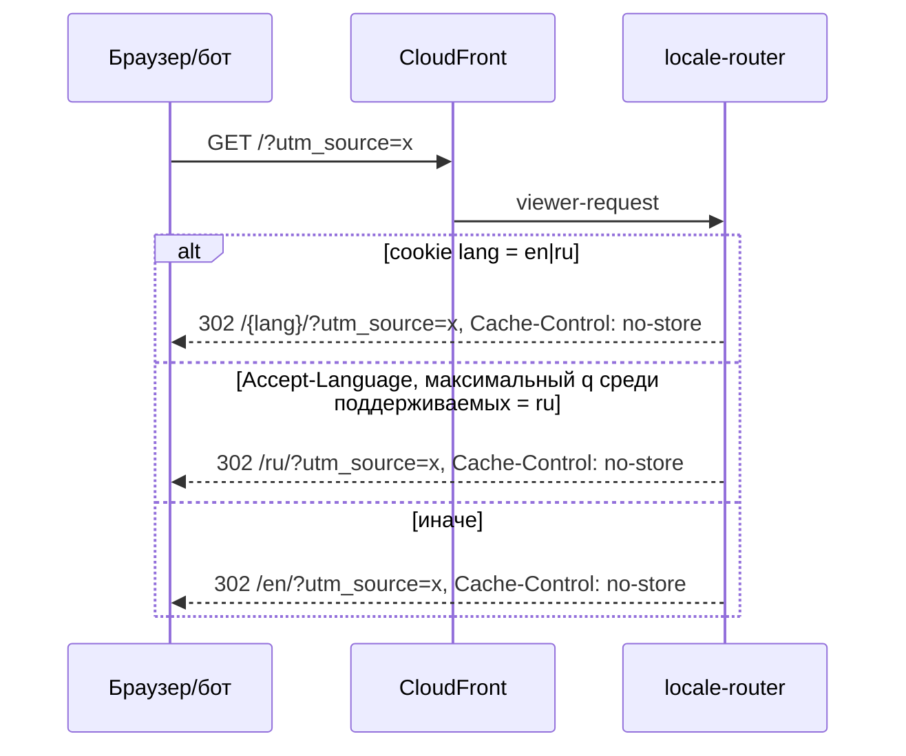
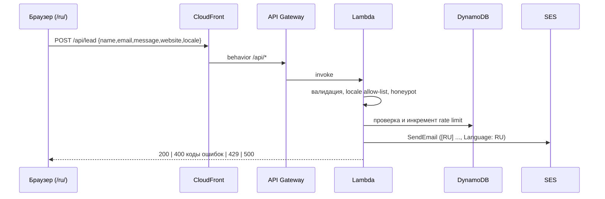

# Архитектура krunai.uz

Источники: `docs/spec/v1-technical.md` (базовое ТЗ), `docs/spec/v2-technical.md` (RU-локализация), `docs/spec/v3-technical.md` (внешний DNS ClouDNS, Zoho, SES domain identity). Решения зафиксированы в ADR: [0001](adr/0001-stack-and-repo-layout.md), [0002](adr/0002-i18n-static-locales.md), [0003](adr/0003-edge-locale-detection.md), [0004](adr/0004-external-dns-ses-domain-identity.md).

## 1. Обзор

Статический двуязычный (EN/RU) одностраничный лендинг платформы KRunAI. Регион AWS — **eu-west-3 (Paris)**, ACM-сертификат для CloudFront — **us-east-1**. Runtime-сервера нет; единственная динамика — CloudFront Function на edge и один serverless-эндпоинт заявок. Lambda@Edge не используется.

```mermaid
flowchart LR
    V[Посетитель] -->|HTTPS| CF[CloudFront<br/>krunai.uz, www.krunai.uz]
    CF -->|viewer-request| FN[CloudFront Function<br/>locale-router]
    CF -->|"/* (OAC)"| S3[(S3 private bucket<br/>eu-west-3)]
    CF -->|"/api/*"| APIGW[API Gateway HTTP API]
    APIGW --> L[Lambda Node.js 20 (TS)<br/>обработчик заявок]
    L --> SES[Amazon SES<br/>eu-west-3, identity krunai.uz]
    L --> DDB[(DynamoDB<br/>rate limit, TTL)]
    L --> CW[CloudWatch Logs]
    SES -->|noreply@krunai.uz → gulmira@krunai.uz| M[Zoho Mail<br/>gulmira@krunai.uz]
    DNS[ClouDNS<br/>вручную клиентом] -.CNAME/ALIAS.-> CF
    DNS -.DKIM, MAIL FROM.-> SES
    ACM[ACM us-east-1] -.TLS.-> CF
```

## 2. Компоненты

| Компонент | Назначение |
|---|---|
| `apps/web` | Next.js 14 App Router, TypeScript strict, Tailwind, `output: 'export'`, `trailingSlash: true`. Результат — `out/` с `en/index.html`, `ru/index.html`, `en/404/index.html`, `ru/404/index.html`. |
| S3 (eu-west-3) | Приватный bucket со статикой, доступ только через CloudFront Origin Access Control (OAC). |
| CloudFront | Один distribution: apex + `www` (неканонический хост → 301 на `canonical_host`, по умолчанию `krunai.uz`; fallback `www.krunai.uz`, ADR 0004), HTTP → HTTPS, TLS 1.2+, Response Headers Policy (HSTS, CSP, X-Frame-Options и др.), standard logs в S3. Default behavior → S3; `/api/*` → API Gateway. |
| CloudFront Function `locale-router` | `infra/functions/`, runtime `cloudfront-js-2.0`, viewer-request на default behavior. Редирект по локали только для `/`; для прочих путей переписывание `/x/` → `/x/index.html`. См. ADR 0003. |
| API Gateway HTTP API | `POST /api/lead`, CORS только `https://krunai.uz` и `https://www.krunai.uz`, throttling (burst 10, rate 5 rps). Контракт — `contracts/openapi.yaml` (тикет T2). |
| Lambda заявок (`apps/api`) | Node.js 20 (TypeScript, бандл esbuild), reserved concurrency ≤ 5. Серверная валидация, honeypot (при заполнении — 200 без отправки), проверка `locale` по allow-list (`en`|`ru`, по умолчанию `en`), rate limit, отправка письма. Ошибки валидации возвращаются кодами. Логи JSON без полного текста сообщения, email маскируется, retention 30 дней. |
| Amazon SES (eu-west-3) | Domain identity `krunai.uz` с Easy DKIM (3 CNAME) и custom MAIL FROM `mail.krunai.uz`; отправка с `noreply@krunai.uz` на `gulmira@krunai.uz` (Zoho), получатель из `LEAD_RECIPIENT_EMAIL`. SPF apex не меняется, DMARC выравнивается через DKIM (`d=krunai.uz`). Верификация адреса получателя не нужна. Письмо на английском, `Reply-To` = email посетителя, в теме тег `[RU]`/`[EN]`, в теле `Language: RU|EN`. |
| DynamoDB | Таблица rate limit (`RATE_LIMIT_TABLE`), счётчики по ключу клиента с TTL. Это serverless-хранилище без постоянных вычислений; заявки в БД не хранятся. Параметры лимита — по `docs/spec/v1-technical.md` (FR-5: throttling и reserved concurrency); пороги по умолчанию: 5 заявок с IP за 600 с (env `RATE_LIMIT_MAX`, `RATE_LIMIT_WINDOW_SECONDS`); ключ `ip#<sha256(ip)>`, TTL в `expiresAt`. |
| ACM / ClouDNS | Сертификат `krunai.uz` + `www.krunai.uz` в us-east-1 с DNS-валидацией. DNS остаётся в ClouDNS (hosted zone в AWS не создаётся): CNAME валидации, записи сайта, DKIM и MAIL FROM клиент добавляет вручную по outputs (раздел 5.1), инструкция — `docs/dns-cloudns.md`. Двухэтапный деплой: `enable_custom_domain=false` → клиент вносит записи → `enable_custom_domain=true` (подключение сертификата и aliases к CloudFront). Записи MX/SPF/DMARC/DKIM Zoho не изменяются (ADR 0004). |
| CloudWatch | Логи Lambda и API GW, alarm на ошибки Lambda > 0 за 5 минут, alarm на bounce rate и complaint rate SES (SNS → `alarm_email`). |
| Terraform (`infra/terraform`) | Terraform >= 1.6, AWS provider ~> 5; state в S3 + DynamoDB lock (eu-west-3). Функция locale-router управляется в IaC вместе с distribution. |
| GitHub Actions (`.github/workflows`) | OIDC в AWS без долгоживущих ключей. Pipeline на push в `main`: lint → typecheck → проверка ключей i18n → build → тесты → S3 sync → CloudFront invalidation. |

Сквозное: Node.js 20 LTS, npm workspaces, документация на русском.

## 3. Потоки запросов

### 3.1. `GET /` — редирект по локали



Порядок: cookie → `Accept-Language` с учётом q → `en`. Query string сохраняется. Cookie `lang=en|ru; Path=/; Max-Age=31536000; SameSite=Lax; Secure` ставит переключатель языка на клиенте. Функция не логирует персональные данные.

### 3.2. `GET /en/`, `GET /ru/` и прочие пути

Редиректов нет: функция только переписывает URI `/x/` → `/x/index.html` (OAC + S3 не умеют index-документы в подкаталогах). `/en/` → `en/index.html`, `/ru/` → `ru/index.html`, 200 с `<html lang>` нужной локали. Прямые ссылки на локаль никогда не редиректятся. Кэширование — как в v1: HTML `no-cache`, ассеты с хэшем `max-age=31536000, immutable`.

### 3.3. Неизвестный путь → 404

S3 с OAC без `s3:ListBucket` возвращает 403 (иначе 404). Custom error response CloudFront для 403 и 404 отдаёт `/en/404/index.html` со статусом 404. Страница 404 определяет локаль по `location.pathname` (`/ru/...` → RU-текст, иначе EN). Для `/ru/...` без точного совпадения пользователь видит русский текст. Подробности и альтернативы — ADR 0002.

### 3.4. `POST /api/lead`



Фронтенд отображает локализованный текст по коду ошибки. Сбой SES → 500 `internal_error` и запись в лог (в ТЗ v1 был 502, контракт T2 использует 500).

### 3.5. Контракт `POST /api/lead`

Источник правды: [`contracts/openapi.yaml`](../contracts/openapi.yaml) (OpenAPI 3.1, линтер: `npx @redocly/cli lint contracts/openapi.yaml`).

Тело запроса (JSON): `name` (1–100, обязательно), `email` (обязательно), `message` (10–2000, обязательно), `locale` (`en`|`ru`, необязательно, по умолчанию `en`), `website` (honeypot, должен быть пустым). Поле `phone` из ориентира тикета не добавлено: его нет в форме v1. Заполненный honeypot → `200 {"ok": true}` без отправки письма.

Сервер не возвращает человекочитаемых текстов, только коды; фронтенд маппит их на локализованные строки.

| HTTP | Тело | Когда |
|------|------|-------|
| 200 | `{"ok": true}` | Успех, в т.ч. сработавший honeypot |
| 400 | `{"error":"validation_error","fields":{"<field>":"<code>"}}` | Ошибка валидации полей (`name`, `email`, `message`, `locale`) |
| 400 | `{"error":"bad_request"}` | Невалидный JSON |
| 429 | `{"error":"rate_limited"}` | Превышен rate limit |
| 500 | `{"error":"internal_error"}` | Внутренний сбой, в т.ч. ошибка SES |

Коды полей (`fields.<field>`):

| Код | Значение |
|-----|----------|
| `required` | Поле отсутствует или пустое |
| `invalid_format` | Неверный формат (например, email) |
| `too_short` | Короче минимума (`message` < 10) |
| `too_long` | Длиннее максимума |
| `invalid_value` | Значение вне допустимого набора (`locale` вне allow-list) |

## 4. Структура репозитория

```
apps/web/              Next.js (статический экспорт), messages/{en,ru}.json
apps/api/              Lambda заявок (Node.js 20, TypeScript) + package.json-обёртка скриптов
infra/functions/       CloudFront Function locale-router
infra/terraform/       Terraform (S3, CloudFront, ACM, API GW, Lambda, SES, DynamoDB, IAM OIDC)
contracts/openapi.yaml OpenAPI контракт POST /api/lead (тикет T2)
design/                бренд-материалы: логотип, палитра, OG-изображение
e2e/                   Playwright E2E по статической сборке
.github/workflows/     CI/CD
docs/                  architecture.md, adr/, spec/
```

Корневой `package.json`: workspaces `["apps/web","apps/api","e2e"]`; скрипты `lint`, `test`, `build` делегируют в workspaces (`--if-present`).

Каталоги `infra/*`, `contracts`, `design`, `.github/workflows` — не npm-пакеты; в каркасе содержат `.gitkeep`, наполняются соответствующими тикетами.

## 5. Переменные окружения

| Переменная | Где | Значение |
|---|---|---|
| `NEXT_PUBLIC_SITE_URL` | фронт, build-time | `https://krunai.uz` (canonical, hreflang, sitemap, og:url) |
| `NEXT_PUBLIC_LEAD_API_PATH` | фронт, build-time | `/api/lead` |
| `LEAD_RECIPIENT_EMAIL` | Lambda | `gulmira@krunai.uz` (значение из переменной Terraform `lead_recipient_email`, из запроса не принимается) |
| `LEAD_FROM_EMAIL` | Lambda | `noreply@krunai.uz` (адрес на SES domain identity `krunai.uz`) |
| `RATE_LIMIT_TABLE` | Lambda | имя DynamoDB-таблицы rate limit |
| `RATE_LIMIT_MAX` | Lambda | `5` |
| `RATE_LIMIT_WINDOW_SECONDS` | Lambda | `600` |
| `ALLOWED_ORIGIN` | Lambda | `https://krunai.uz` (www тоже допустим по v1 FR-5; список уточняется при реализации/T2) |

Секреты в репозитории не хранятся; AWS-доступ в CI — через OIDC.

### 5.1. Переменные и outputs Terraform

| Переменная | Значение по умолчанию | Назначение |
|---|---|---|
| `domain_name` | `krunai.uz` | Домен сайта и SES identity |
| `canonical_host` | `krunai.uz` (допустимо `krunai.uz` \| `www.krunai.uz`) | Канонический хост; `www.krunai.uz`, если в ClouDNS нет ALIAS |
| `enable_custom_domain` | `false` | Этап 2: подключить ACM-сертификат и aliases к CloudFront |
| `lead_recipient_email` | `gulmira@krunai.uz` | Источник `LEAD_RECIPIENT_EMAIL` |
| `lead_from_email` | `noreply@krunai.uz` | Источник `LEAD_FROM_EMAIL` |
| `ses_mail_from_subdomain` | `mail` | Поддомен custom MAIL FROM (`mail.krunai.uz`) |
| `alarm_email` | без default | Получатель SNS-уведомлений алармов |

| Output | Содержимое |
|---|---|
| `cloudfront_domain_name` | `<id>.cloudfront.net` |
| `acm_validation_records` | список `{name,type,value}` для валидации сертификата |
| `dns_records` | записи сайта (apex ALIAS/CNAME, www CNAME) |
| `ses_dkim_records` | 3 CNAME `<token>._domainkey` → `<token>.dkim.amazonses.com` |
| `ses_mail_from_records` | MX `mail` → `10 feedback-smtp.eu-west-3.amazonses.com`; TXT `mail` → `v=spf1 include:amazonses.com ~all` |

Записи MX, SPF, DMARC и DKIM Zoho **не изменяются** и в outputs/таблицу не входят.

### 5.2. Открытые вопросы ТЗ v3 и влияние на реализацию

| Вопрос | Влияние |
|---|---|
| Есть ли ALIAS в тарифе ClouDNS | Нет → `canonical_host = "www.krunai.uz"`, apex редиректит на www в ClouDNS; синхронизировать `NEXT_PUBLIC_SITE_URL`, canonical/hreflang, sitemap |
| Есть ли DMARC | Нет → в `docs/dns-cloudns.md` опциональная `_dmarc` `p=none`; есть → не трогаем |
| Несколько получателей | Сейчас один адрес; расширение потребует изменения формата `LEAD_RECIPIENT_EMAIL` и кода `apps/api` (вне текущего объёма) |

Подробности — [ADR 0004](adr/0004-external-dns-ses-domain-identity.md).

## 6. i18n и SEO

- Локали: `en` (default/fallback), `ru`. Сообщения: `apps/web/messages/{en,ru}.json`, список локалей — единый модуль `apps/web/src/i18n/config.ts` (ADR 0002).
- CI-проверка: ключи `en` и `ru` совпадают, иначе сборка падает.
- На каждой странице: `<html lang>`, canonical, `hreflang` en/ru/x-default (→ `/en/`), `og:locale` (`en_US`/`ru_RU`) + `og:locale:alternate`; `sitemap.xml` с обеими локалями и alternates.
- Шрифты с кириллицей; вёрстка выдерживает длинные RU-строки при 320 px.

## 7. Как добавить новую локаль

Например, `uz`:

1. Создать `apps/web/messages/uz.json` с тем же набором ключей, что в `en.json`.
2. Добавить `uz` в список локалей `apps/web/src/i18n/config.ts` (и в маппинг `og:locale`, например `uz_UZ`). Страницы `/uz/`, `/uz/404/`, hreflang и sitemap генерируются из этого списка (`generateStaticParams`).
3. Если локаль должна определяться автоматически — добавить её в список поддерживаемых в `infra/functions/locale-router` (ADR 0003) и в allow-list `locale` в `apps/api` и `contracts/openapi.yaml`.
4. Добавить локализованный текст 404 и обновить E2E.
5. Прогнать `npm run lint && npm run build` (проверка ключей) и задеплоить.

Новая инфраструктура не требуется.

## 8. Нефункциональные требования и ограничения

- Только serverless/managed; новой runtime-инфраструктуры сверх CloudFront Function не добавляется.
- Lighthouse (mobile) ≥ 90 по всем категориям в обеих локалях; нет overflow на 320/768/1440 px.
- S3 не публичен; HSTS, CSP, TLS 1.2+.
- Вне рамок: другие локали, CMS для переводов, локализованные письма владельцу, аналитика, БД лидов.
